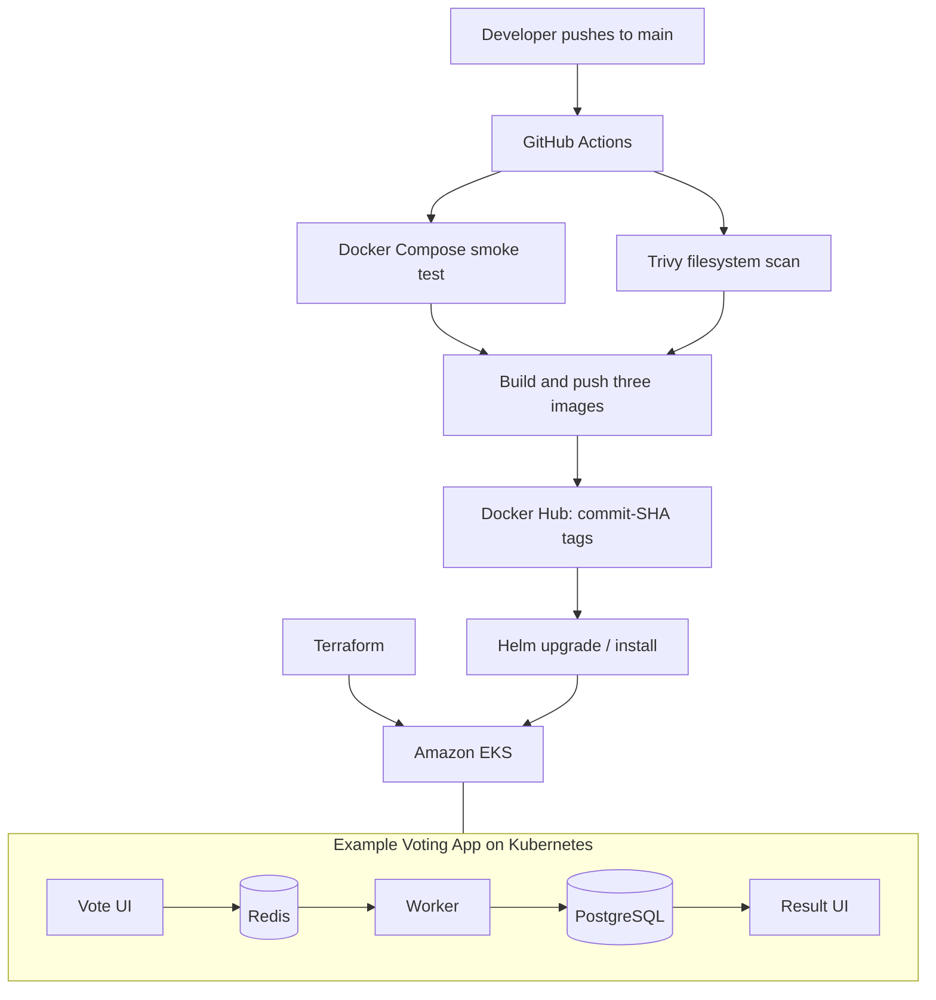

# Capstone 1 — Ship It: Automated Voting App Deployment

A DevOps capstone demonstrating how to **build, test, security-scan, publish, deploy, and roll back** a containerized microservices application using GitHub Actions, Docker, Terraform, Amazon EKS, and Helm.

**Repository:** [edikky/voting-app](https://github.com/edikky/voting-app)  
**Upstream project:** [dockersamples/example-voting-app](https://github.com/dockersamples/example-voting-app)  
**AWS region:** `us-east-1`  
**EKS cluster:** `edikky-voting-cluster`  
**Kubernetes namespace:** `voting`  
**Helm release:** `voting`

## Project objectives

- Package the Vote, Result, and Worker services as Docker images.
- Provision a Kubernetes environment using Terraform.
- Automate smoke testing, vulnerability scanning, and image publishing with GitHub Actions.
- Deploy versioned images to Amazon EKS using a single Helm chart.
- Demonstrate recovery by rolling back a Helm release to an earlier version.
- Keep credentials and Terraform state out of Git.

## Architecture



An additional architecture reference is available at [`architecture.excalidraw.png`](architecture.excalidraw.png).

### Application components

| Component | Purpose |
|---|---|
| `vote` | Web interface for casting votes |
| `redis` | Queue for incoming votes |
| `worker` | Processes votes from Redis and writes to PostgreSQL |
| `db` | PostgreSQL database |
| `result` | Web interface for displaying vote results |

## Repository structure

| Path | Purpose |
|---|---|
| `vote/`, `result/`, `worker/` | Application services and Docker build contexts |
| `terraform/` | Infrastructure-as-code for EKS and supporting AWS resources |
| `helm/voting-app/` | Helm chart for deploying all application components |
| `.github/workflows/ci-cd.yml` | CI/CD automation |
| `docker-compose.yml` | Local multi-container application |
| `architecture.excalidraw.png` | Architecture image |

## Prerequisites

For a local run: Docker Engine and Docker Compose. For cloud deployment: an AWS account with appropriate permissions, AWS CLI, Terraform, `kubectl`, Helm, and Docker Hub access. GitHub Actions requires configured repository secrets for Docker Hub and AWS.

## 1. Run the application locally

From the repository root:

```bash
docker compose up -d --build
```

Open:

- Vote: http://localhost:8080
- Results: http://localhost:8081

Stop the local environment:

```bash
docker compose down
```

## 2. Provision Kubernetes with Terraform

```bash
cd terraform
terraform init
terraform plan
terraform apply
aws eks update-kubeconfig --name edikky-voting-cluster --region us-east-1
kubectl get nodes
cd ..
```

**Cost warning:** Amazon EKS and the associated AWS resources can incur charges while provisioned. When the environment is no longer required, review the Terraform plan and clean up with `terraform destroy` from the `terraform/` directory. Do not destroy the environment before finishing any required live demonstration.

## 3. GitHub Actions CI/CD pipeline

Workflow: [`.github/workflows/ci-cd.yml`](.github/workflows/ci-cd.yml)

The workflow supports pushes to `main`, pull requests targeting `main`, and manual execution via `workflow_dispatch`.

| Stage | Behavior |
|---|---|
| Smoke test | Starts the app with Docker Compose and checks Vote and Result pages |
| Trivy security scan | Scans the checked-out filesystem for HIGH and CRITICAL findings |
| Build and push | On pushes to `main`, builds Vote, Result, and Worker images and pushes SHA and `latest` tags to Docker Hub |
| Deploy to EKS | On pushes to `main`, checks for the configured EKS cluster and runs `helm upgrade --install` if it exists |

**Important implementation details:**

- The Trivy step currently uses `exit-code: '0'`, so findings are **reported but do not fail the workflow**. This is an advisory scan, not a blocking security gate.
- The deploy step **skips deployment if the EKS cluster does not exist**. A green workflow run alone therefore does not guarantee that a deployment occurred. Verify the deployment job logs and the live Helm release.
- Image tags use `${{ github.sha }}` for traceability. The Helm command passes this tag via `global.tag`.
- Docker Hub and AWS credentials are supplied through GitHub Actions secrets. No credentials should be committed to the repository.

## 4. Deploy using Helm

After connecting `kubectl` to the cluster:

```bash
helm upgrade --install voting ./helm/voting-app \
  -n voting --create-namespace \
  --set global.tag=<existing-docker-image-sha> \
  --wait --timeout 5m

kubectl get deployments -n voting
helm status voting -n voting
```

For local access, use separate terminals:

```bash
kubectl port-forward -n voting svc/vote 8080:5000
```

```bash
kubectl port-forward -n voting svc/result 8081:5001
```

Then open http://localhost:8080 and http://localhost:8081. The services may also be exposed through the chart's configured Kubernetes service types; port-forwarding is useful for a controlled local demonstration.

## 5. Verified rollback demonstration — October 29, 2026

A controlled rollback was executed against the live `voting` Helm release. Before rolling back, Docker Hub manifests were checked for all three older application images (Vote, Result, and Worker), and each image was available.

**Sequence executed:**

```bash
# Roll back from revision 2 to the earlier release
helm rollback voting 1 -n voting --wait --timeout 5m

# Restore the newer release after the rollback demonstration
helm rollback voting 2 -n voting --wait --timeout 5m

# Confirm release history and workload health
helm history voting -n voting
kubectl get pods -n voting
```

**Observed Helm history:**

| Revision | Outcome | Description |
|---|---|---|
| 1 | Superseded | Install complete |
| 2 | Superseded | Upgrade complete |
| 3 | Superseded | Rollback to 1 |
| **4** | **Deployed** | **Rollback to 2** |

**Verified outcome:** Helm reported success for both operations. After restoring revision 2, all five application pods (`db`, `redis`, `result`, `vote`, `worker`) were `1/1 Running` with zero reported restarts. Revision 4 was the deployed release.

This demonstrates release rollback and restoration using Helm. It does **not** claim that an intentionally broken release was deployed or that a complete disaster-recovery test was performed.

## 6. Security and operational considerations

- Docker Hub and AWS authentication credentials are provided as GitHub Actions secrets.
- Terraform state and local secrets must remain excluded from Git; confirm exclusions before committing changes.
- This sample application uses demonstration database credentials; these are **not appropriate for production**.
- The Trivy scan is currently advisory (`exit-code: '0'`). A production pipeline should consider explicit risk-based blocking gates.
- The deploy workflow skips if the cluster is missing. A production deployment workflow should clearly surface skipped deployments or enforce a required environment.
- Run `kubectl get deployments -n voting`, `helm status voting -n voting`, and application smoke tests when verifying a release.

## 7. Submission evidence checklist

The following items support the capstone demonstration. Capture screenshots or links before deprovisioning AWS infrastructure:

- [ ] GitHub Actions run showing smoke test, security scan, three image builds, and deploy job results.
- [ ] Terraform configuration and, if available, provisioning output or EKS cluster view.
- [ ] Helm chart and architecture diagram.
- [x] Live CLI output showing five healthy Voting App deployments/pods.
- [x] Helm release history showing revision 3 (**Rollback to 1**) and revision 4 (**Rollback to 2**, deployed).
- [ ] Screenshots of Vote and Result pages working after restoration.
- [ ] Confirmation that no credentials or Terraform state files were committed.

## Assessment summary

The implementation demonstrates a reproducible infrastructure definition, GitHub Actions automation, Docker image versioning, Helm-based deployment, and a verified rollback-and-restore sequence. Security findings are currently reported without blocking builds, and deployment is conditional on cluster availability; those design choices are documented explicitly rather than presented as stronger guarantees.
