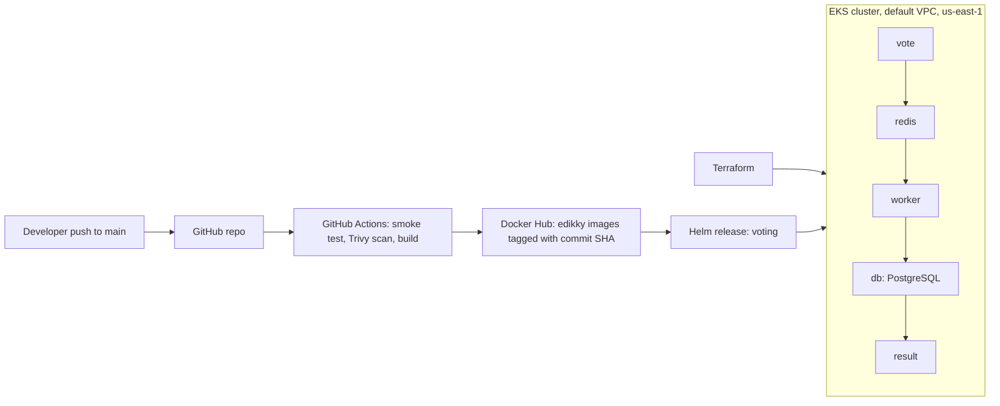

# Voting App: Capstone 1 (Ship It)

A voting app (vote, result, worker, Redis, PostgreSQL) built into container images by GitHub Actions, run on an Amazon EKS cluster created with Terraform, and released with Helm.

Forked from `dockersamples/example-voting-app`.

## Architecture



## What is in this repo

| Path | Purpose |
|------|---------|
| `vote/`, `result/`, `worker/` | The three services. Each Dockerfile pins its base image, runs as a non-root user, and has a `.dockerignore`. |
| `terraform/` | Creates the EKS cluster and node group in the default VPC. |
| `helm/voting-app/` | One Helm chart and one `values.yaml` for the whole app. |
| `.github/workflows/ci-cd.yml` | CI pipeline. |

## 1. Run it locally

```bash
docker compose up --build
```

Vote at http://localhost:8080 and see results at http://localhost:8081.

## 2. Create the cluster (Terraform)

```bash
cd terraform
terraform init
terraform apply
aws eks update-kubeconfig --name edikky-voting-cluster --region us-east-1
kubectl get nodes
```

To tear it down: `terraform destroy`. The cluster can be recreated from code with `terraform apply`.

## 3. CI pipeline (GitHub Actions)

Every push to `main` runs:

1. A smoke test that starts the app and checks the vote and result pages.
2. A Trivy security scan.
3. A build and push of the three images to Docker Hub, tagged with the commit SHA and `latest`.

Docker Hub credentials are stored as GitHub secrets (`DOCKERHUB_USERNAME`, `DOCKERHUB_TOKEN`) and are not in the repo.

## 4. Deploy and roll back (Helm)

```bash
helm upgrade --install voting ./helm/voting-app -n voting --create-namespace --set global.tag=<commit-sha>
kubectl get pods -n voting
kubectl port-forward -n voting svc/vote 8080:5000
kubectl port-forward -n voting svc/result 8081:5001
```

Rollback demo: a bad release is shipped on purpose, then rolled back.

```bash
helm upgrade voting ./helm/voting-app -n voting --set global.tag=doesnotexist --wait --timeout 60s
helm history voting -n voting
helm rollback voting 1 -n voting
```

## Security notes

- No access keys, tokens or Terraform state are committed. See `.gitignore`.
- The app code uses the sample PostgreSQL credentials, and the database is only reachable inside the cluster (`ClusterIP`).